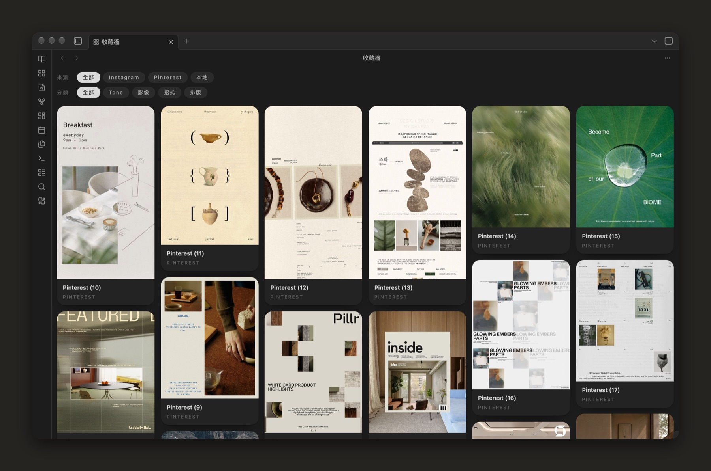
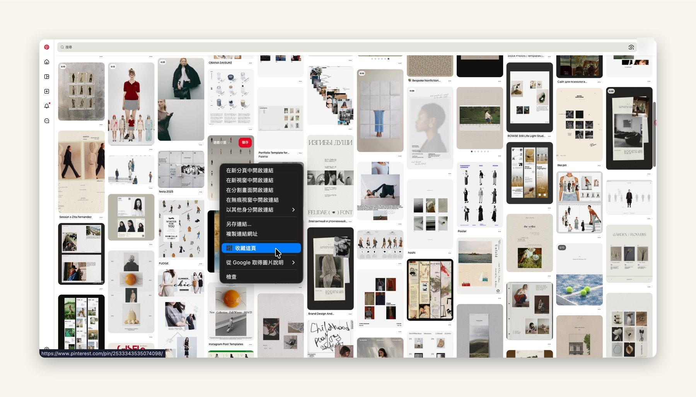

# Collection Wall 收藏牆 — 右鍵把網頁收進 Obsidian（給 AI 蓋的規格書）

> 這個 repo **沒有程式碼**。它是一份施工圖：把整包丟給你的 AI（Claude Code / Codex / Cursor 都行），
> 它會照著蓋出一個能跑的版本，收藏放在你自己的 Obsidian 保管庫裡。
>
> **English:** No source here. This is a build spec dense enough that a coding agent can implement
> a "save this page to Obsidian" tool from scratch: a Chrome context-menu extension, a localhost relay
> living inside an Obsidian plugin, a zero-dependency Python capturer, and a masonry wall view.
> Read `BUILD.md`. The security rules in `SPEC.md` are not optional.



## 蓋出來的東西長怎樣

在 Chrome 任何一頁按右鍵 →「收藏這頁」。十幾秒後，Obsidian 裡多一則筆記、一張封面，牆上多一張卡。



- **瀑布流面板**：欄寬固定，高度跟著圖片原始比例，每張放進目前最矮的那一欄
- **兩排篩選**：來源（哪個網站）／分類。一則可以同時屬於好幾個分類
- **一則收藏＝一則普通筆記**：frontmatter 記網址、封面、分類，正文隨你寫。不綁資料庫，外掛拿掉筆記還在
- **封面一律存到本機**：圖床網址常帶簽章，過幾天就失效
- **右鍵點在圖上＝那張就是封面**；點在空白處就用頁面的 `og:image`
- **影片也能收**：把影片拖進一則收藏筆記，自動抽一格有畫面的當封面
- **卡片右鍵**：開筆記／開原網址／複製網址／在 Finder 顯示封面／刪除（筆記與封面一起進垃圾桶）
- **選配：AI 看圖分類**。預設關閉，打開才會把封面送給你自己選的模型服務（見下方「界線」）

我自己拿它做什麼：收排版、色調、鏡頭這類視覺參考。書籤只留得住網址，截圖會散在桌面；
收進 Obsidian 之後跟筆記放在一起，點一下分類就篩出來。

## 它怎麼接起來

```
Chrome 右鍵「收藏這頁」
  └→ 擴充背景程式：在你正在看的那一頁裡讀 og:image／標題／描述
       └→ POST http://127.0.0.1:<PORT>/collect        ← 只收自己那支擴充（SPEC「安全規則」）
            └→ Obsidian 外掛（本機中繼）
                 └→ execFile python3 擷取器 --import <暫存.json>
                      └→ 下載封面 →（選配）分類 → 寫筆記進保管庫 → 回一行 JSON
                           └→ 頁面底部浮一行字「收進『排版』：……」
```

中間為什麼要繞一圈 Obsidian，而不是讓 Chrome 直接寫檔：macOS 對瀏覽器起的程序有一道**不跳詢問的檔案權限牆**。
`PITFALLS.md` 第 1 條有完整推理過程，這條最值錢。

## 怎麼叫 AI 蓋

把這個資料夾放進一個空專案，然後跟你的 agent 說：

```
讀 BUILD.md，照第 0 到第 6 階段依序蓋。
每階段做完先跑 ACCEPTANCE.md 對應那節的驗收，過了才准做下一階段。
SPEC.md 的「安全規則」一條都不准放寬。
遇到 PITFALLS.md 提到的症狀先查那份，別自己重推。
```

**階段 1–3 蓋完就能用**（命令列收藏＋牆）。右鍵收藏是階段 4，影片封面是 5，AI 分類 6 是選配。

## 你要自己準備的

| 需要 | 說明 |
|---|---|
| Obsidian 桌面版 | 外掛用到 Node 的 `http` 與 `child_process`，手機版跑不了 |
| Python 3.9+ | 擷取器只用標準函式庫 |
| Chrome 或 Chromium 系瀏覽器 | 擴充沒上商店，用「開發人員模式 › 載入未封裝項目」 |
| openssl | 產生一把金鑰，讓擴充 ID 固定（一次就好） |
| ffmpeg（選配） | 影片抽封面。沒有 ffprobe 也行 |
| 能看圖的 LLM CLI（選配） | 自動分類用，例如 Codex CLI 或 Claude Code |

我只在 macOS 上跑過。架構在 Windows／Linux 一樣成立，但 python、ffmpeg 的路徑與檔案權限行為要自己驗。

## 授權與界線

- 這份規格書 MIT（`LICENSE`）
- 這份 repo **不含任何收藏資料**（筆記、封面檔、分類設定）。`docs/` 兩張截圖是我自己的牆與瀏覽畫面，畫面裡的作品版權屬各原作者，只作示意。你蓋出來的版本，收藏留在你自己的保管庫，外掛設定檔（裡面有你的路徑）也別進 repo。`.gitignore` 已經先擋了
- **它讀的是你自己已登入的瀏覽器裡、你正在看的那一頁。** 不代登入、不批次爬、不繞過任何網站的防護。
  請遵守各網站的使用條款，收藏只供個人參考
- **本機伺服器是一道門。** 規格強制：只聽 `127.0.0.1`、只收自己那支擴充的 Origin、驗 Host、封面網址只收公開的 http/https。
  放寬任何一條，你打開的任何網頁都可能往你的保管庫塞東西、叫你的電腦去抓內網位址
- **AI 分類是選配，預設關。** 打開之後，每收一則都會把**封面圖、標題、頁面描述**送給你設定的那個模型服務，
  走那個服務的帳號、計費與資料條款。不想讓圖離開本機就別開，或接一個本機模型
- 擴充的私鑰（`.pem`）放在擴充資料夾和 repo **外面**，絕不 commit

## 檔案

```
BUILD.md        施工順序（給 AI 讀的主文件）
SPEC.md         契約：筆記欄位、資料夾、HTTP 端點、擴充 JSON、安全規則、分類器介面
PITFALLS.md     三十二條靜默地雷，這份最值錢
ACCEPTANCE.md   每階段的驗收，含可直接複製的安全測試
CLAUDE.md       agent 一進 repo 先讀的東西
docs/           截圖
```
